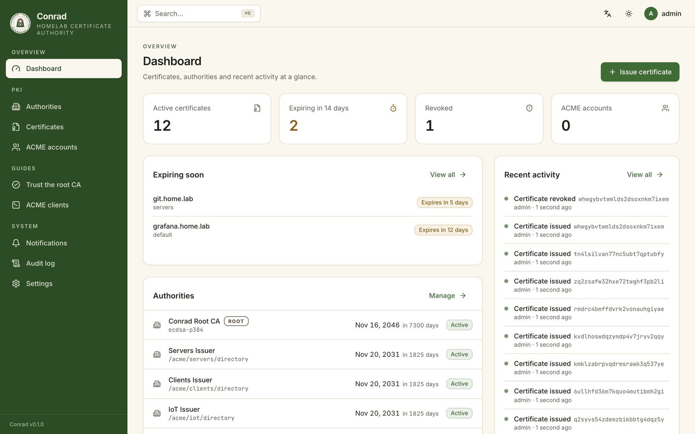
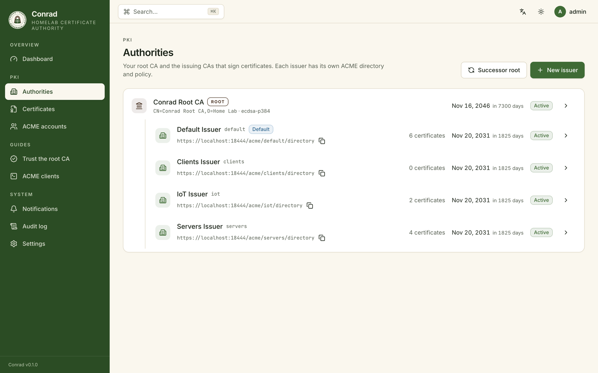
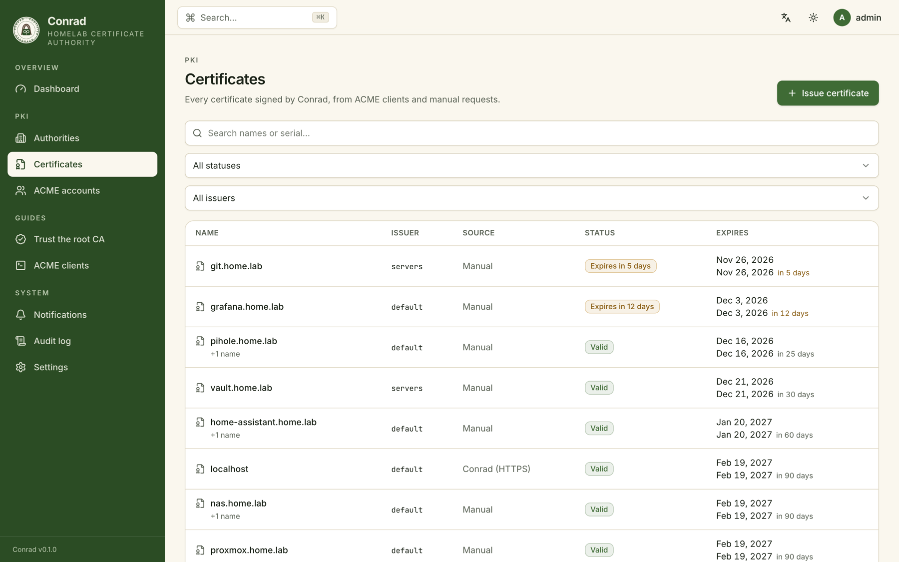
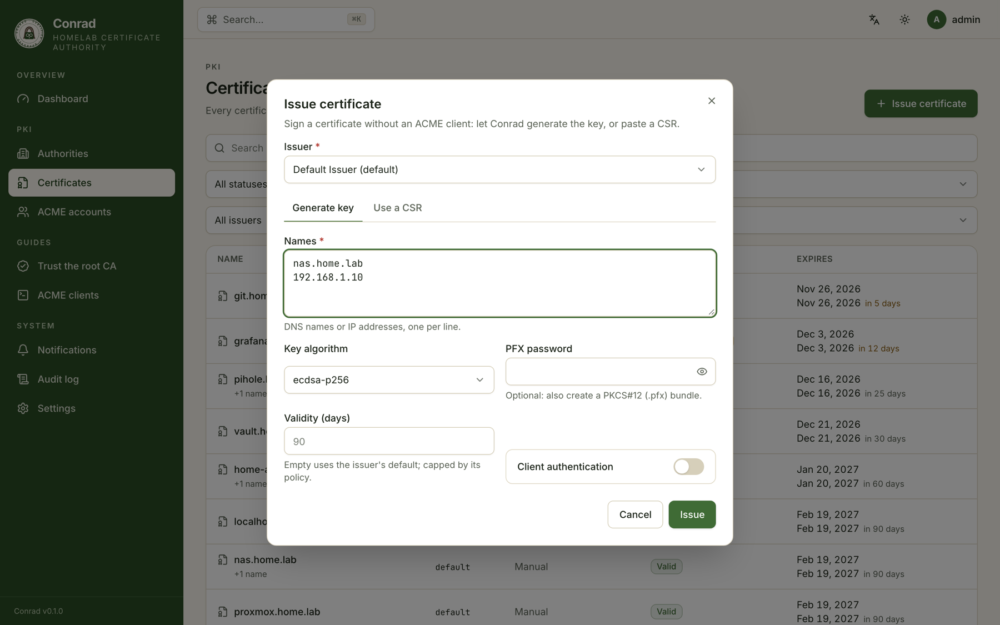
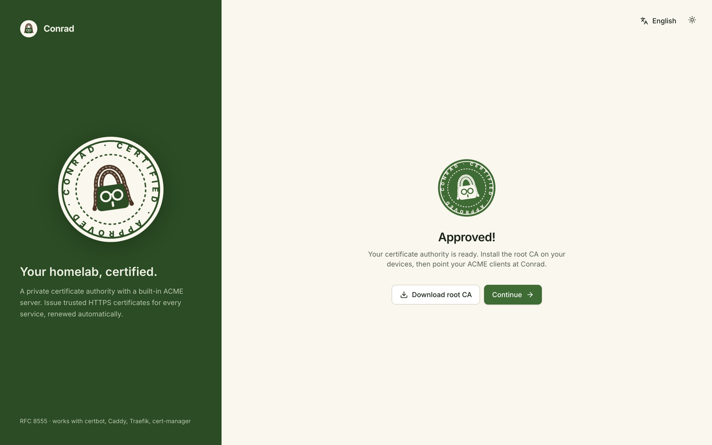

<p align="center">
  
</p>

<h1 align="center">Conrad</h1>

<p align="center">
  <b>Your homelab, certified.</b><br>
  A self-hosted certificate authority with a built-in ACME server.<br>
  Real HTTPS for every service on your LAN, renewed automatically, from one small binary.
</p>

<p align="center">
  <a href="https://github.com/davidemaggi/Conrad/actions/workflows/ci.yml"></a>
  <a href="https://github.com/davidemaggi/Conrad/releases/latest"></a>
  <a href="https://github.com/davidemaggi/Conrad/pkgs/container/conrad"></a>
  
  <a href="LICENSE"></a>
</p>

<p align="center">
  <a href="#quick-start">Quick start</a> ·
  <a href="#features">Features</a> ·
  <a href="#screenshots">Screenshots</a> ·
  <a href="docs/install.md">Docs</a>
</p>

<p align="center">
  <picture>
    <source media="(prefers-color-scheme: dark)" srcset="docs/screenshots/dashboard-dark.png">
    
  </picture>
</p>

---

## Why Conrad?

Browser warnings on `https://nas.home.lab`, self-signed certificates copied by hand, a wildcard you forgot to renew. Sound familiar?

Conrad gives your network its own private PKI and speaks ACME, the protocol Let's Encrypt uses. So **certbot, acme.sh, Caddy, Traefik, cert-manager and lego work out of the box**: point them at Conrad and they issue and renew certificates for your internal hostnames, with no public DNS and no ports opened to the internet.

- 🔒 **Trusted everywhere you install the root.** No more "proceed anyway".
- 🔁 **Hands-off renewals.** Your ACME clients renew. Conrad warns you if something is about to expire.
- 📦 **One binary, zero dependencies.** Server, web UI and SQLite database in a single static executable. No CGO, no Postgres, no Redis.
- 🧭 **Guided setup.** Running in minutes from a browser wizard, no OpenSSL incantations.

## Quick start

```sh
docker run -d --name conrad -p 80:80 -p 443:443 \
  -e CONRAD_HOSTNAMES=ca.home.lab -v conrad-data:/data \
  ghcr.io/davidemaggi/conrad:latest

docker logs conrad | grep setup_token
```

1. Open `https://ca.home.lab` (accept the temporary self-signed certificate once).
2. Paste the setup token, then create your admin, root CA and first issuer.
3. Install the root on your devices from `https://ca.home.lab/roots/current.crt`. The **Trust the root CA** guide in the UI covers every OS and browser.

Conrad then switches its own HTTPS to a certificate from your new CA. Now request a certificate like you would from Let's Encrypt:

```sh
certbot certonly --standalone -d nas.home.lab \
  --server https://ca.home.lab/acme/default/directory
```

That's it. 🎉

> Prefer something else? Binaries for Linux, macOS and Windows (amd64/arm64) are on the [releases page](https://github.com/davidemaggi/Conrad/releases), and there are a [docker-compose file](deploy/docker-compose.yml) and a [systemd unit](docs/install.md).

## Features

| | |
|---|---|
| **Full ACME (RFC 8555)** | http-01, dns-01 and tls-alpn-01 challenges, External Account Binding, ARI renewal info, revocation, key rollover. |
| **Multiple issuers** | One root, as many intermediate issuers as you want. Each has its own ACME directory and policy: allowed domains, wildcards, IPs, key types, validity, rate limits. |
| **Root rollover** | Create a successor root with cross-signing, so devices keep trusting your certificates during the transition. |
| **Modern web UI** | Dashboard, manual issuance (server-generated key or your CSR, PFX export), revocation, ACME accounts, EAB keys, audit log, command palette. Light and dark themes, English and Italian. |
| **Notifications** | Expiry warnings and events by email (SMTP with none/STARTTLS/TLS) or HMAC-signed webhooks, to Slack, ntfy, Home Assistant and friends. |
| **Keys stay safe** | CA keys encrypted at rest with your passphrase (Argon2id + AES-256-GCM), or kept in an HSM via PKCS#11 (YubiHSM, SoftHSM, Nitrokey…). |
| **SSO ready** | Password login, plus OIDC with Authelia, Authentik, Keycloak or any compliant provider. |
| **Ops friendly** | Online backups, CRLs, `/healthz`, structured logs, Docker images (static and PKCS#11), systemd unit. |

## Screenshots

<table>
  <tr>
    <td width="50%"><p align="center"><sub><b>Authorities</b>: a root and its issuers, each with its own ACME directory</sub></p></td>
    <td width="50%"><p align="center"><sub><b>Certificates</b>: everything Conrad signed, with expiry at a glance</sub></p></td>
  </tr>
  <tr>
    <td width="50%"><p align="center"><sub><b>Manual issuance</b>: no ACME client needed for that one odd device</sub></p></td>
    <td width="50%"><p align="center"><sub><b>Setup wizard</b>: from zero to a working CA in a couple of minutes</sub></p></td>
  </tr>
</table>

## Works with

**certbot** · **acme.sh** · **Caddy** · **Traefik** · **cert-manager** · **lego** · **win-acme** · anything that speaks ACME.
Ready-to-paste snippets are in [docs/acme-clients.md](docs/acme-clients.md) and in the **ACME clients** guide inside the UI.

## Documentation

- [Installation](docs/install.md): Docker, compose, binaries, systemd
- [Configuration](docs/configuration.md): every option and environment variable
- [ACME clients](docs/acme-clients.md): certbot, Caddy, Traefik, cert-manager and more
- [Backup and restore](docs/backup.md)
- [PKCS#11 / HSM](docs/pkcs11.md)

## Building from source

Requires Go 1.26+ and Node 24+.

```sh
make build      # web UI + static binary in bin/conrad
make test       # Go and web tests
make dev        # Vite dev server proxied to a local Conrad
```

PKCS#11 support needs CGO and sits behind a build tag: `CGO_ENABLED=1 go build -tags pkcs11 ./cmd/conrad`.

## Scope

Conrad is built for homelabs and small networks: one administrator, one node. High availability is on the roadmap. It is a **private** CA, so its certificates are trusted only by devices where you install its root.

## Contributing

Issues and pull requests are welcome. If Conrad saves you from one more browser warning, a ⭐ helps others find it.

## License

[GPL-3.0](LICENSE)
